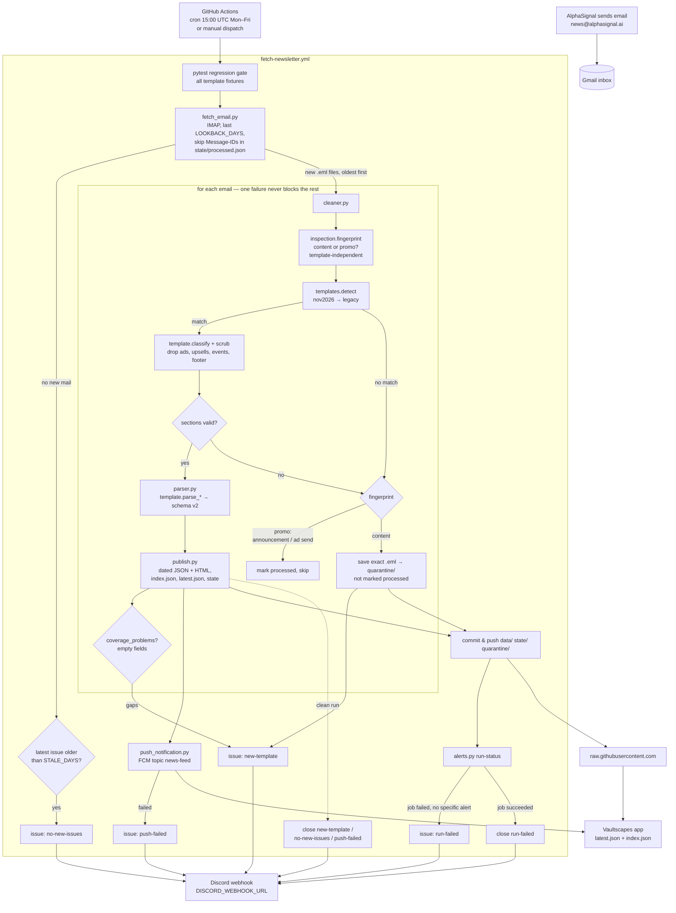

# Vaultscapes News Feed — AlphaSignal Newsletter Automation

Automated pipeline that turns the daily [AlphaSignal](https://alphasignal.ai)
newsletter email into clean, structured JSON hosted on GitHub — the data
source for the Vaultscapes app's native AI news feed. Every supported email
layout (template) is parsed into **one stable schema**, so the app never
changes when AlphaSignal redesigns its email.

## Workflow



## Architecture

```
scripts/
├── run_pipeline.py        orchestrator: fetch → clean → parse → publish, per email
├── fetch_email.py         Gmail IMAP fetch, Message-ID dedup
├── cleaner.py             template-agnostic: container, detection, validation, render
├── parser.py              template-agnostic: assembles schema v2; Deep Dive articles
├── publish.py             dated files, index.json, latest.json, state
├── push_notification.py   FCM topic push for the newest issue
├── inspection.py          template-independent: content-vs-promo fingerprint, coverage check
├── alerts.py              GitHub issues (open / comment / close) mirrored to Discord
├── templates/             ← every layout-specific rule lives here
│   ├── __init__.py        registry + detect() (newest first, legacy fallback)
│   ├── base.py            EmailTemplate contract + shared helpers
│   ├── legacy.py          layout used until mid-Nov 2026
│   └── nov2026.py         layout used from 2026-11-23
└── utils/
    ├── helpers.py         env, IST dates, paths, tracking-link resolver
    └── markers.py         markers shared by all layouts (sender, tracking, stats)
tests/                     regression tests, one fixture per template
format/                    reference emails for each template
data/                      published feed (see below)
state/processed.json       handled Gmail Message-IDs (idempotency)
state/pushed.json          last iso_date announced via FCM
quarantine/                exact .eml of possible new templates (older runs: raw .html)
```

### Template strategy

The email is ~70 nested tables with almost no usable CSS classes. The one
stable invariant: a single `<td>` holds one direct child `<table>` per visual
section. The **core** (`cleaner.py` / `parser.py`) only knows that invariant;
everything about how a section *looks* is delegated to a template object:

| Hook | Purpose |
|---|---|
| `matches(tables, texts)` | does this email use this layout? |
| `classify(table, text)` | `intro` / `summary` / `news` / `signals` / `article` / `author`, or `None` = junk |
| `scrub(kind, table)` | remove sponsor fragments *inside* a kept section |
| `parse_intro` / `parse_summary` / `parse_news_block` / `parse_signals` | section → schema dicts |

All templates stay registered, so the scraper handles **every** layout at once —
old emails, backfills and mixed inboxes all parse. Detection runs newest first
on each template's own landmarks (`nov2026`: `Summary … read`; `legacy`:
`Summary Read time:` or a `Deep Dive` kicker). If none match, `detect()`
returns `None` — no template guesses at a layout it doesn't know.

| Template | Layout landmarks | Reference |
|---|---|---|
| `legacy` | `Summary Read time: …`, `▸ headline` rows, ranked signals `1 … 5,367 Likes`, `READ MORE` | `format/legacy.eml`, `tests/fixtures/sample.eml`, article fixtures |
| `nov2026` | `Summary 6 min 0 sec read`, `→ headline · TOP MODEL` rows, `▲ 3,714 Likes`, unranked signals with thumbnails, `Read more` | `format/nov26.eml`, `tests/fixtures/nov2026.eml` |

Both accept the plain `Hey,` and the personalised `Hey <Name>,` greeting
(introduced in Nov 2026 on both layouts). Long-form **Deep Dive** articles are
generic `<p>/<ul>/` extraction and stay in `parser.py`.

### Detecting a new template, skipping promo sends

AlphaSignal never announces a redesign, and also sends pure promo mail from
the same address (e.g. `format/announcement.eml`: "AlphaSignal will never be
the same." — pricing, coupon, sign-up steps; no news). Templates can't tell
these apart, because a redesign by definition matches no template. So the
decision is made by `scripts/inspection.py`, which fingerprints the **content
pattern** every newsletter has carried across all layouts, not the markup:

| Evidence | Weight | legacy | nov26 | Deep Dive | announcement |
|---|---|---|---|---|---|
| engagement stats `N Likes/Stars/Downloads` ≥ 3 | 3 | 8 | 10 | 0 | 0 |
| headline links (`class="h1"`) ≥ 3 | 2 | 13 | 14 | 1–2 | 0 |
| `Summary`, `Signals`, read-time phrase, `Top <Category>` | 1 each | ✓ | ✓ | – | – |
| `Deep Dive` kicker | 2 | – | – | ✓ | – |
| long paragraphs ≥ 8 | 2 | 2–5 | 5 | 13–22 | 1 |
| content images ≥ 2 | 1 | 8 | 12 | 4–7 | 3 |
| **score** (max of digest / article) | | 9 | 9 | 5 | 1 |

Score ≤ 1 = **promo** → skipped and marked processed, no issue. Anything
higher is treated as newsletter content, and then:

| Situation | Outcome |
|---|---|
| a template matches and its sections validate | published |
| content, but **no template matches** | `new-template` issue, not published |
| content, a template matches but **sections are missing** | `new-template` issue (names the template), not published |
| published, but **fields a correct parse always fills are empty** (`coverage_problems`: news body/likes/image/link, signal stats, read time, summary ↔ news links) | published, `new-template` issue flagging the gaps |

The issue carries the subject, Message-ID, which template matched (if any),
why it counts as content, the fingerprint, and the leading text of every
top-level section. The **exact `.eml` is saved to `quarantine/`** and
committed, since a template is written from the real email. The email is not
marked processed, so the first run after the new template lands publishes it
automatically, as long as it is still inside `LOOKBACK_DAYS`.

**Adding a new layout** (always by hand, from the saved `.eml`):

1. Copy the saved `.eml` to `format/` and `tests/fixtures/`; copy the closest
   module in `scripts/templates/` to a new file.
2. Adjust its markers, `matches()`, `classify()`, `scrub()` and `parse_*`.
3. Register it first in `TEMPLATES` in `scripts/templates/__init__.py`.
4. Add a test like `tests/test_nov2026.py` (sections, junk dropped, payload
   shape equals legacy, `coverage_problems() == []`).
5. Push, then run the workflow with a `LOOKBACK_DAYS` covering the email; the
   clean run closes the `new-template` issue.

`cleaner.py`, `parser.py` and the app need no changes.

### What gets removed

Anything a template's `classify()` does not recognise is dropped, plus
section-internal scrubbing:

- header nav, logo, "Today's Author" card (kept only as an article byline)
- "In Partnership with" banner inside the intro
- "Presented by …" sponsor boxes between news items
- sponsored entries in the summary outline (legacy: sponsor category rows and
  `N. Name:` previews; nov2026: any `· SUFFIX` that isn't `TOP …`)
- sponsored signals ("Presented by …"), ranks renumbered
- "Your feed …" / "AlphaSignal PRO" upsells, "Our Events", "From <sponsor>"
  article ads
- footer, feedback poll, unsubscribe, open-tracking pixel; click-tracking links
  resolved to their final destinations

## Alerts: GitHub issues + Discord

`scripts/alerts.py` keeps **one open issue per label**: a repeat is a comment
on the open issue, not a new one. Every open / comment / close is mirrored to
Discord via `DISCORD_WEBHOOK_URL`. Successful publishes are **not** posted —
Discord only hears about problems and their resolution. Issues are only filed inside GitHub Actions; local
runs print instead.

| Label | Important | Opened when | Closed when |
|---|---|---|---|
| `new-template` | ✓ | content no template could parse, or a parse with empty fields (see above; exact `.eml` → `quarantine/`) | a run publishes and every email parsed cleanly |
| `run-failed` | ✓ | the job failed and no specific alert explains it (IMAP login, test gate, crash) | the next successful run |
| `no-new-issues` | ✓ | nothing published for `STALE_DAYS` (default 4) | an issue is published |
| `push-failed` | | FCM push failed (bad service account, FCM error) | the next delivered push |

A drifted email is **not** marked processed, so once a template fixes it the
next run (with `LOOKBACK_DAYS` wide enough) publishes it automatically.

## Setup

1. **GitHub Secrets** (repo → Settings → Secrets and variables → Actions):

   | Secret | Purpose |
   |---|---|
   | `GMAIL_ADDRESS` | Gmail address receiving AlphaSignal |
   | `GMAIL_APP_PASSWORD` | Google app password (requires 2FA) |
   | `FCM_SERVICE_ACCOUNT` | Firebase service account JSON for push |
   | `DISCORD_WEBHOOK_URL` | Discord channel for alert issues (problems only) |

   `GH_TOKEN` is the workflow's own token; the workflow grants it
   `contents: write` and `issues: write`.
2. The workflow (`.github/workflows/fetch-newsletter.yml`) runs weekdays at
   15:00 UTC, or manually via *Actions → Fetch AlphaSignal Newsletter → Run
   workflow*. Reruns are idempotent.

> **Security note:** a Gmail app password grants full IMAP access to the
> account, not a read-only scope. Keep the repo's collaborator list tight and
> rotate the app password if that changes. For a shared setup, migrate to the
> Gmail API with OAuth `gmail.readonly`.

## Local development

```bash
python3 -m venv work/venv && work/venv/bin/pip install -r requirements.txt
cp .env.example .env                 # FEED_GITHUB_REPO (+ Gmail creds for live fetch)

# full pipeline on a fixture (offline, no Gmail):
work/venv/bin/python scripts/run_pipeline.py --eml tests/fixtures/nov2026.eml --no-resolve

# tests:
work/venv/bin/python -m pytest tests/ -q

# live fetch; widen the window to backfill missed issues:
LOOKBACK_DAYS=8 work/venv/bin/python scripts/run_pipeline.py
```

| `.env` key | Purpose |
|---|---|
| `FEED_GITHUB_REPO` | `owner/name` for absolute raw URLs in `index.json` (CI falls back to `GITHUB_REPOSITORY`) |
| `FEED_GITHUB_BRANCH` | branch for raw URLs (default `main`) |
| `FEED_RAW_BASE` | optional explicit base-URL override |
| `GMAIL_ADDRESS` / `GMAIL_APP_PASSWORD` | local live fetch only; CI uses Secrets |
| `LOOKBACK_DAYS` | IMAP search window in days (default 3) |
| `STALE_DAYS` | days without a publish before `no-new-issues` (default 4) |
| `DISCORD_WEBHOOK_URL` | optional locally; set it only if local runs should post alerts |

## Data layout

```
data/
├── latest.json               newest issue — the app's primary fetch
├── index.json                manifest (newest first) with absolute raw URLs
└── 2026/11-November/
    ├── 26-11-2026.json       one issue (schema below)
    └── html/26-11-2026.html  cleaned HTML audit artifact
```

## JSON schema (version 2)

Every template emits exactly this shape; `type` discriminates digests from
long-form articles.

```jsonc
// type: "digest"
{
  "version": 2,
  "type": "digest",
  "date": "26-11-2026",          // DD-MM-YYYY, IST
  "iso_date": "2026-11-26",      // for sorting
  "subject": "…email subject…",
  "intro": "…editorial intro…",
  "read_time": "6 min 0 sec",
  "summary": [
    { "category": "Top Model", "headline": "…", "news_id": "news-1" }
  ],
  "news": [
    {
      "id": "news-1",
      "category": "Top Model",   // "Top News", "Top Repo", "Top Model", …
      "headline": "…",
      "likes": 3714,
      "body": "…paragraphs…",
      "bullets": ["…"],
      "image_url": "https://alphasignal.ai/image/….png",
      "read_more_url": "https://…resolved final URL…"
    }
  ],
  "signals": [
    { "rank": 1, "headline": "…",
      "stat": { "type": "likes", "value": 3117 },   // likes | stars | downloads
      "url": "https://…resolved final URL…" }
  ]
}

// type: "article" (Sunday / Technical Deep Dive)
{
  "version": 2, "type": "article", "date": "…", "iso_date": "…", "subject": "…",
  "kicker": "Sunday Deep Dive",
  "title": "…",
  "author": { "name": "Ben Dickson", "bio": "…" },
  "intro": "…",
  "blocks": [
    { "kind": "heading", "text": "…" },
    { "kind": "paragraph", "html": "…<a href> <b> <i> <code> only…" },
    { "kind": "list", "ordered": false, "items": ["…html…"] },
    { "kind": "image", "src": "…", "alt": "…" }
  ]
}
```

`index.json` → `{ updated_at, latest_url, issues[] }`, each issue
`{ date, iso_date, type, subject, path, json_url, html_url, headlines[] }`
(+ `title`, `kicker` for articles).

App consumption: `GET <raw-base>/data/latest.json` for the newest issue,
`GET <raw-base>/data/index.json` for history/search. The
`raw.githubusercontent.com` CDN caches ~5 minutes.

## Failure behaviour

- **No new email** (weekend/holiday): exit 0, no commit; `no-new-issues` only
  after `STALE_DAYS`.
- **Promo send** (announcements, upsells, ad-only mail; fingerprint score ≤ 1):
  marked processed, skipped, no issue.
- **Possible new template**: exact `.eml` committed to `quarantine/`,
  `new-template` issue + Discord alert, job goes red. Other emails in the same
  run still publish; `latest.json` never receives a malformed issue.
- **Duplicate run**: `state/processed.json` makes reruns no-ops;
  `state/pushed.json` prevents double pushes.
